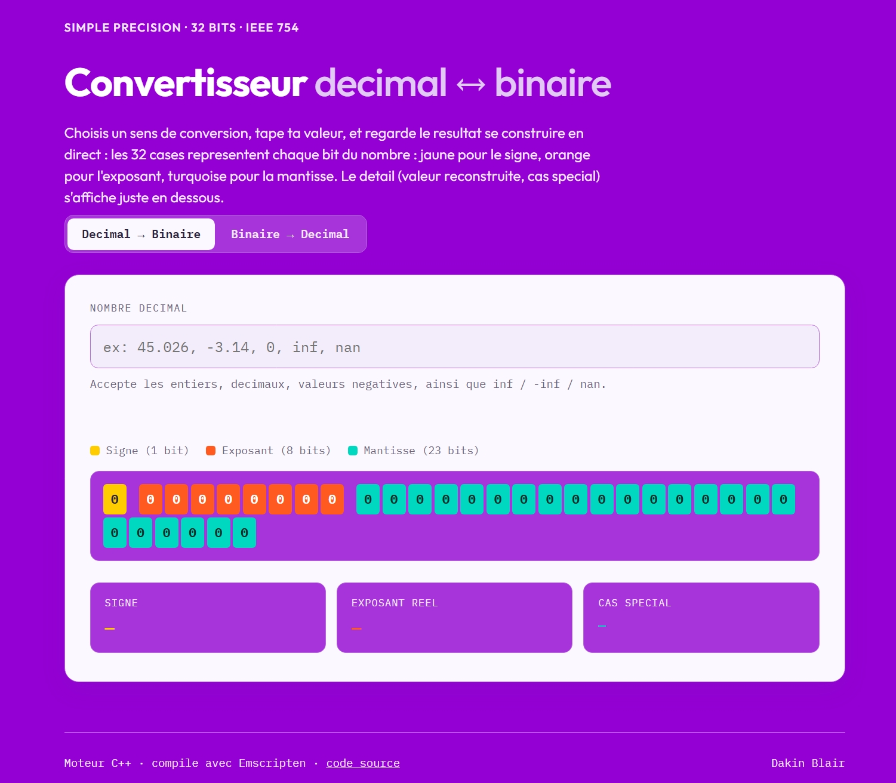
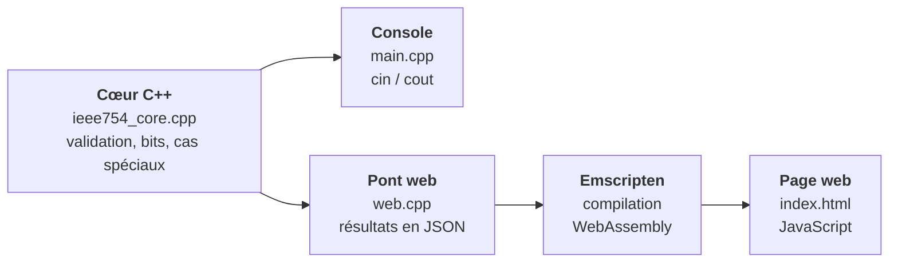
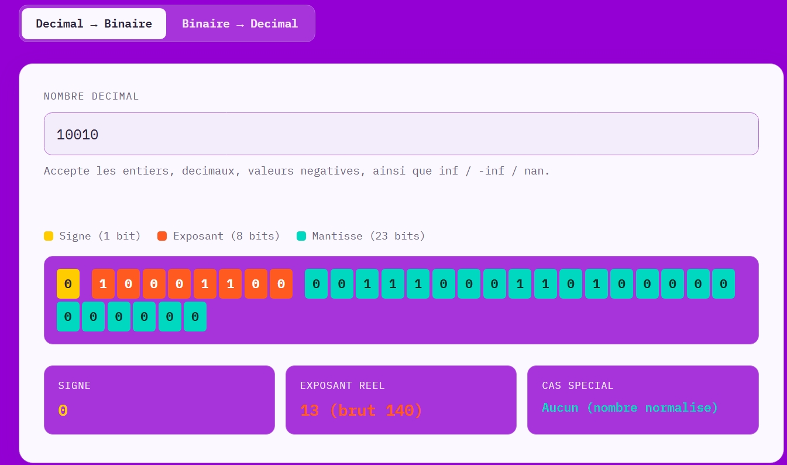
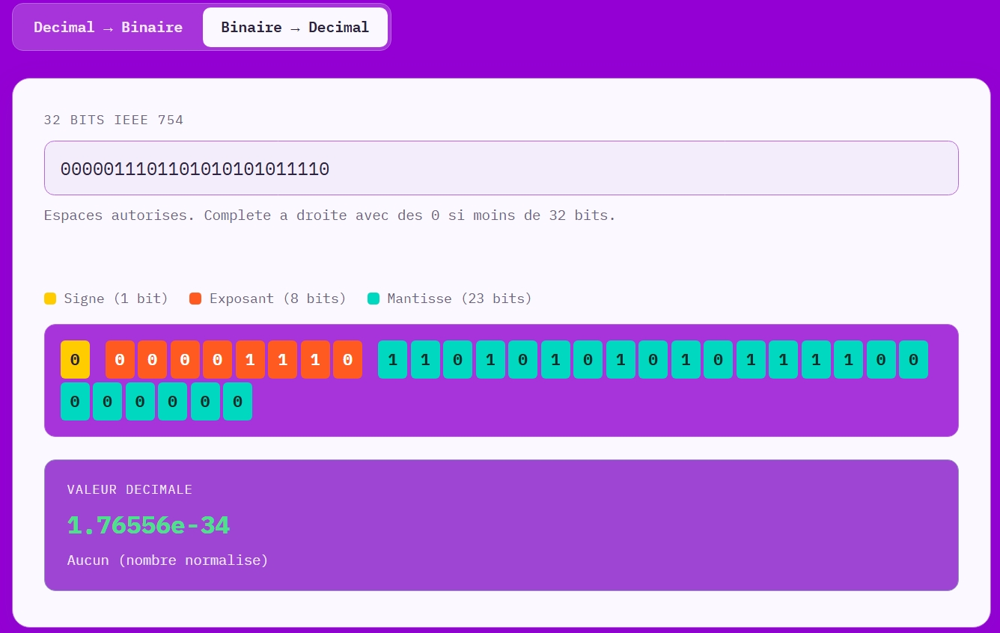

# Norme-IEEE — Convertisseur IEEE 754 simple précision

> Convertisseur **décimal ↔ binaire** selon la norme **IEEE 754 simple précision (32 bits)**, écrit en **C++**. Il est disponible en version console et en version web compilée en **WebAssembly**.


Projet réalisé par **Noubouossie Dakin Blair**.
Cours **[SIGLE — Nom du cours]** · Université du Québec en Outaouais · **[Session]**

**Essayer en ligne : [dakin-blair.github.io/Norme-IEEE](https://dakin-blair.github.io/Norme-IEEE/)**

<p align="center">
  
  <br><em>Convertisseur en ligne (GitHub Pages)</em>
</p>

---

## Sommaire

- [La norme IEEE 754](#la-norme-ieee-754)
- [Architecture](#architecture)
- [Résultats](#résultats)
- [Tests](#tests)
- [Difficultés rencontrées](#difficultés-rencontrées)
- [Compiler soi-même](#compiler-soi-même)
- [Contenu du dépôt](#contenu-du-dépôt)
- [Auteur](#auteur)

---

## La norme IEEE 754

Un nombre réel en simple précision est codé sur **32 bits**, divisés en trois champs :

| Champ | Bits | Rôle |
|---|:-:|---|
| Signe | 1 | `0` = positif, `1` = négatif |
| Exposant | 8 | Exposant réel + **biais de 127** |
| Mantisse | 23 | Partie fractionnaire (le `1` implicite n'est pas stocké) |

Valeur d'un nombre normalisé : **(−1)^signe × 1,mantisse × 2^(exposant − 127)**

Le programme reconnaît aussi les **cas spéciaux** :

| Exposant | Mantisse | Cas |
|:-:|:-:|---|
| `00000000` | `0` | Zéro positif ou négatif (**+0 / −0**) |
| `00000000` | ≠ `0` | Nombre **dénormalisé** |
| `11111111` | `0` | Infini (**+inf / −inf**) |
| `11111111` | ≠ `0` | **NaN** (*Not a Number*) |
| autre | quelconque | Nombre **normalisé** |

## Architecture

La logique de conversion est isolée dans un **cœur sans entrée/sortie** (`src/ieee754_core.cpp`). La version console et la version web l'utilisent sans modification.



| Composant | Fichier | Rôle |
|---|---|---|
| Cœur de conversion | `src/ieee754_core.h/.cpp` | Validation des entrées, décomposition des 32 bits, détection des cas spéciaux |
| Version console | `src/main.cpp` | Menu interactif (`cin` / `cout`) |
| Pont C++ → JavaScript | `web/web.cpp` | Expose `decimalVersBinaireJSON` et `binaireVersDecimalJSON` |
| Interface web | `web/index.html` | Charge le module WebAssembly et affiche les résultats |
| Déploiement | `.github/workflows/deploy.yml` | Compile en WebAssembly et déploie sur GitHub Pages à chaque push sur `master` |

## Résultats

**Décimal → binaire**

| Entrée | Signe | Exposant | Mantisse | Cas |
|---|:-:|:-:|---|---|
| `-6.25` | 1 | `10000001` | `10010000000000000000000` | Normalisé |
| `45.026` | 0 | `10000100` | `01101000001101010100000` | Normalisé |
| `0.1` | 0 | `01111011` | `10011001100110011001101` | Normalisé (arrondi) |
| `-0` | 1 | `00000000` | `00000000000000000000000` | Zéro négatif |
| `inf` | 0 | `11111111` | `00000000000000000000000` | Infini positif |
| `nan` | 0 | `11111111` | `10000000000000000000000` | NaN |

**Binaire → décimal**

| Entrée | Valeur | Remarque |
|---|---|---|
| `01000000010010010000111111011011` | **3.141593** | π en simple précision |
| `1100000011` | **-6.000000** | 10 bits saisis, complétés à 32 bits par des `0` à droite |
| `00000000000000000000000000000001` | 0.000000 | Plus petit dénormalisé (affichage limité à 6 décimales) |

## Tests

**Version console** : menu, conversion décimal → binaire et décomposition des champs.



**Version web** : mêmes conversions dans le navigateur.



Entrées invalides gérées : caractères autres que `0`/`1` en binaire, plusieurs points décimaux, signe mal placé, choix de menu invalide. La virgule est acceptée comme séparateur décimal (`3,14`).

## Difficultés rencontrées

| Problème | Cause | Solution |
|---|---|---|
| Programme console impossible à exécuter dans un navigateur | Lecture avec `cin` dans une boucle bloquante | Logique extraite dans un cœur sans E/S (`ieee754_core.cpp`), réutilisé par la console et le web |
| Échange de données entre C++ et JavaScript | Une structure C++ ne passe pas directement vers JavaScript | `web.cpp` renvoie les résultats sous forme de chaîne **JSON** |
| Fichier `.wasm` séparé à héberger | Chargement d'un second fichier par la page | Option `SINGLE_FILE=1` : le WebAssembly est intégré dans `ieee754.js` |

**Limites connues** : la notation scientifique (`1e-40`) n'est pas acceptée, et la valeur décimale est affichée avec 6 décimales seulement.

## Compiler soi-même

**Version console (g++)**

```bash
g++ -std=c++17 -O2 src/main.cpp src/ieee754_core.cpp -o convertit
./convertit
```

**Version web (Emscripten requis)**

```bash
./build.sh
```

Le site se redéploie automatiquement à chaque `git push` sur **`master`**. Pour l'activer une seule fois : **Settings → Pages → Source → GitHub Actions**.

## Contenu du dépôt

| Dossier / fichier | Description |
|---|---|
| [`src/ieee754_core.h`](src/ieee754_core.h), [`src/ieee754_core.cpp`](src/ieee754_core.cpp) | Logique de conversion, sans entrée/sortie |
| [`src/main.cpp`](src/main.cpp) | Version console |
| [`web/web.cpp`](web/web.cpp) | Pont C++ → JavaScript (Emscripten) |
| [`web/index.html`](web/index.html) | Page du convertisseur en ligne |
| [`build.sh`](build.sh) | Compilation locale du module WebAssembly |
| [`.github/workflows/deploy.yml`](.github/workflows/deploy.yml) | Compilation et déploiement sur GitHub Pages |
| [`convertit.cpp`](convertit.cpp), [`convertit.exe`](convertit.exe) | Version console originale, avant la séparation |
| [`images/`](images/) | Captures d'écran |

## Auteur

| Membre |
|---|
| Noubouossie Dakin Blair |
